# StockRoom — DevOps Capstone Project

| | |
|---|---|
| Student | Kartavya Panchal |
| Roll number | 24bcs10343 |
| Demo video | [demo/video.mp4](demo/video.mp4) |
| Slides | [demo/slides.pptx](demo/slides.pptx) · [demo/slides.pdf](demo/slides.pdf) |
| Green pipeline run | [CI/CD run #1](https://github.com/kartavya37/stockroom-devops-capstone/actions/runs/38919883026) |

## Project description and purpose

StockRoom is a stock control app for a small warehouse. You add items with a SKU, a category, a quantity, a unit price and a reorder level. The dashboard shows the total stock value and flags every item at or below its reorder level, so you know what to order next.

The app is small on purpose. The purpose of the project is the delivery chain around it: automated tests, containers, a CI/CD pipeline with a security scan, AWS infrastructure from Terraform, Kubernetes with Helm and Argo CD, and monitoring with Prometheus and Grafana.

## Architecture

```text
 Developer ── git push ──► GitHub (main)
                              │
                              ▼
                       GitHub Actions
       1. test ──► 2. build + Trivy scan + push to GHCR ──► 3. write SHA into Helm values
                                                                      │
                                              Argo CD watches the repo ◄┘
                                                      │
                                                      ▼
                         Kubernetes namespace "stockroom"
             Ingress ── /     ──► frontend  (React + Nginx, 2 Pods)
                     └─ /api  ──► backend   (FastAPI, 2 Pods) ──► PostgreSQL 16
                                       ▲
             Prometheus ── scrapes /metrics (ServiceMonitor) ──► Grafana dashboard

 Terraform ──► AWS ap-south-1: VPC with 2 public subnets + EKS cluster with a node group
```

## Tech stack

| Area | Tools |
|---|---|
| Languages | Python 3.12, JavaScript (React 18) |
| Backend | FastAPI, SQLAlchemy 2, Alembic, PostgreSQL 16 |
| Frontend | React 18, Vite 5, Nginx 1.30 |
| Tests | pytest, in-memory SQLite test database |
| Containers | Docker, Docker Compose |
| CI/CD | GitHub Actions, GitHub Container Registry (GHCR) |
| Security | Trivy |
| Infrastructure | Terraform, AWS VPC, Amazon EKS |
| Kubernetes | Helm, ingress-nginx, Argo CD, Minikube |
| Observability | kube-prometheus-stack (Prometheus, Grafana) |

### API

| Method | Path | Purpose |
|---|---|---|
| GET | `/health` | Liveness check |
| GET | `/ready` | Readiness check (database reachable) |
| GET | `/metrics` | Prometheus metrics |
| GET | `/api/items` | List items (`?category=`, `?low_stock=true`) |
| GET | `/api/items/{id}` | Get one item |
| POST | `/api/items` | Create an item |
| PUT | `/api/items/{id}` | Update an item |
| DELETE | `/api/items/{id}` | Delete an item |
| GET | `/api/items/stats` | Item count, units, stock value, low-stock count |

Swagger UI is at `/docs`. The `items` table is created by the Alembic migration `backend/alembic/versions/0001_create_items.py`.

### Repository layout

```text
backend/             FastAPI app, Alembic migration, pytest tests, Dockerfile
frontend/            React app, Nginx config, multi-stage Dockerfile
docker-compose.yml   the full stack on one machine
.github/workflows/   CI/CD pipeline
terraform/           AWS VPC + EKS
k8s/                 namespace manifest
helm/stockroom/      Helm chart
gitops/              Argo CD Application
monitoring/          kube-prometheus-stack values
demo/                presentation video and slides
screenshots/         screenshots listed in GRADING.md
```

## Local setup

Requirement: Docker with Docker Compose.

```bash
docker compose up --build
```

- App: http://localhost:3000
- API docs: http://localhost:8000/docs
- Metrics: http://localhost:8000/metrics

Stop with `docker compose down`. Add `-v` to delete the database volume.

Run the tests:

```bash
cd backend
python3 -m venv .venv
source .venv/bin/activate
pip install -r requirements.txt
pytest -v
```

The 12 tests use an in-memory SQLite database (`tests/conftest.py` overrides the database dependency), so they never touch PostgreSQL. Both images run as non-root users: the backend as UID 10001 and Nginx as UID 101.

## CI/CD pipeline

`.github/workflows/ci-cd.yml` runs on every push to `main`:

| Job | What it does |
|---|---|
| **1. Test backend and build frontend** | `pytest -v` and the React build. A failing test stops the pipeline. |
| **2. Build, scan and push images** | Builds the backend and frontend images, scans both with Trivy, then pushes them to GHCR. A fixable HIGH or CRITICAL CVE stops the job before the push. |
| **3. Update Helm image tag for Argo CD** | Writes the new tag into `helm/stockroom/values.yaml` and commits it. Argo CD sees the commit and deploys it. |

The image tag is the Git commit SHA, never `latest`:

```text
ghcr.io/kartavya37/stockroom-backend:<commit SHA>
ghcr.io/kartavya37/stockroom-frontend:<commit SHA>
```

### Trivy scan result

Trivy scanned the OS packages and the Python and Node libraries in both images, and the pipeline fails on any HIGH or CRITICAL vulnerability that has a fix. Our first scan failed both images: 20 findings in the backend, including CVE-2026-13221 (CRITICAL) in the Debian `perl-base` package of the Python base image, and 43 in the frontend's `nginx:1.27-alpine` base, mostly OpenSSL. After `apt-get upgrade` / `apk upgrade` in the Dockerfiles, FastAPI 0.143.2 and `nginx:1.30-alpine`, both images scan clean, so no known fixable HIGH or CRITICAL vulnerability ships in them.

## Terraform

`terraform/` creates in `ap-south-1`:

- a VPC with two public subnets in two availability zones
- an EKS 1.36 cluster with a managed node group of two `t3.medium` workers

```bash
cd terraform
cp terraform.tfvars.example terraform.tfvars
terraform init
terraform plan
terraform apply
aws eks update-kubeconfig --region ap-south-1 --name stockroom-dev-eks
terraform destroy
```

No credentials are in the repository. Terraform uses the AWS CLI credentials on the machine.

## Kubernetes and Helm deployment

The demo cluster is Minikube with the `ingress` add-on.

```bash
kubectl apply -f k8s/namespace.yaml
helm upgrade --install stockroom ./helm/stockroom -n stockroom -f helm/stockroom/values-dev.yaml
kubectl get pods -n stockroom
kubectl get svc -n stockroom
helm list -n stockroom
```

The chart deploys PostgreSQL with a volume, the backend and the frontend with 2 replicas each, ClusterIP services, and an Ingress for the host `stockroom.local` that sends `/` to the frontend and `/api` to the backend.

### GitOps with Argo CD

`gitops/argocd-application.yaml` points Argo CD at `helm/stockroom` on `main`, with automatic sync, prune and self-heal:

```bash
helm uninstall stockroom -n stockroom      # Argo CD takes over the deployment
kubectl apply -f gitops/argocd-application.yaml
```

From then on a `git push` is the deployment. The pipeline commits the new image tag, and Argo CD syncs it to the cluster.

## Observability

```bash
helm repo add prometheus-community https://prometheus-community.github.io/helm-charts
helm upgrade --install monitoring prometheus-community/kube-prometheus-stack \
  -n monitoring --create-namespace -f monitoring/prometheus-values.yaml
```

- The backend exposes Prometheus metrics at `/metrics`.
- The chart's ServiceMonitor makes Prometheus scrape the backend.
- The chart's dashboard ConfigMap adds a **StockRoom API** dashboard to Grafana: requests per second, p95 latency, 5xx error rate, backend Pods up, and CPU per Pod.

## Screenshots

| What | Screenshot |
|---|---|
| Running app in the browser (M1) |  |
| `pytest -v`, all tests passing (M2) | 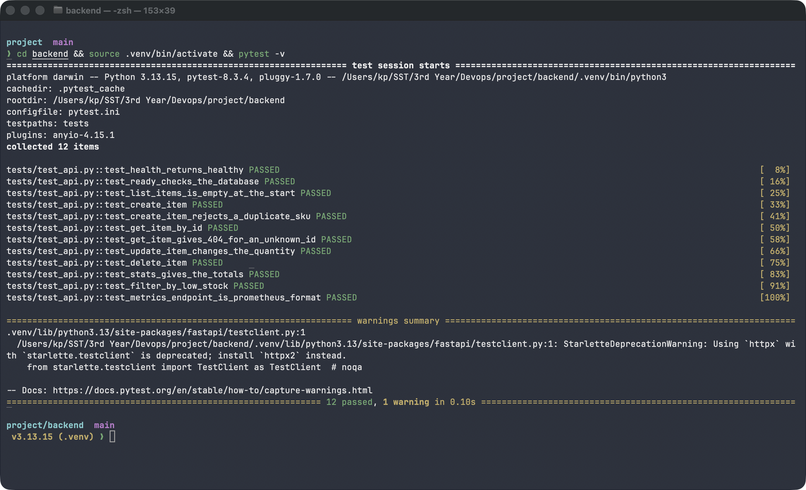 |
| Commit history (M3) | 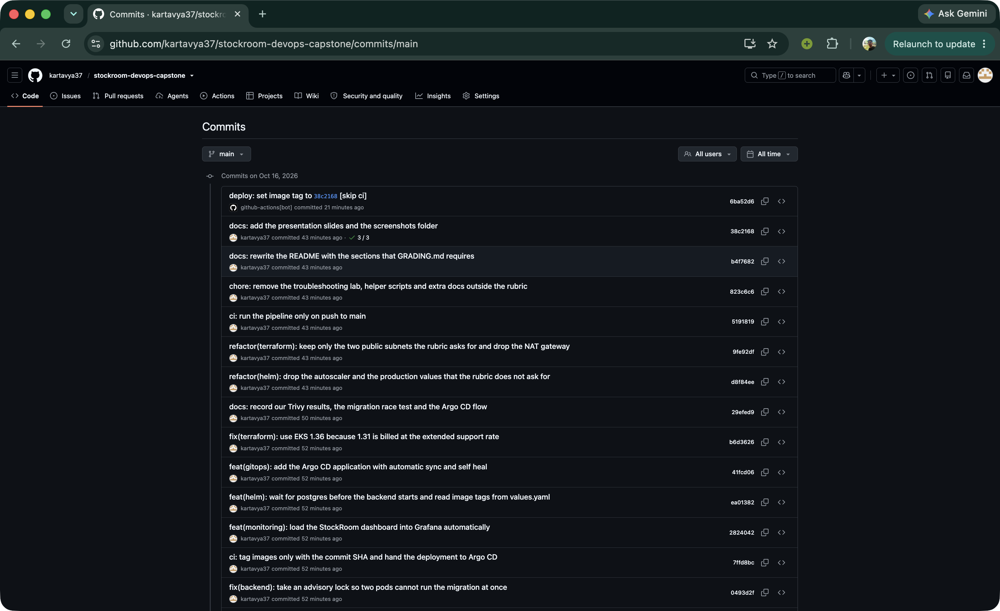 |
| `docker compose up --build` (M4) | 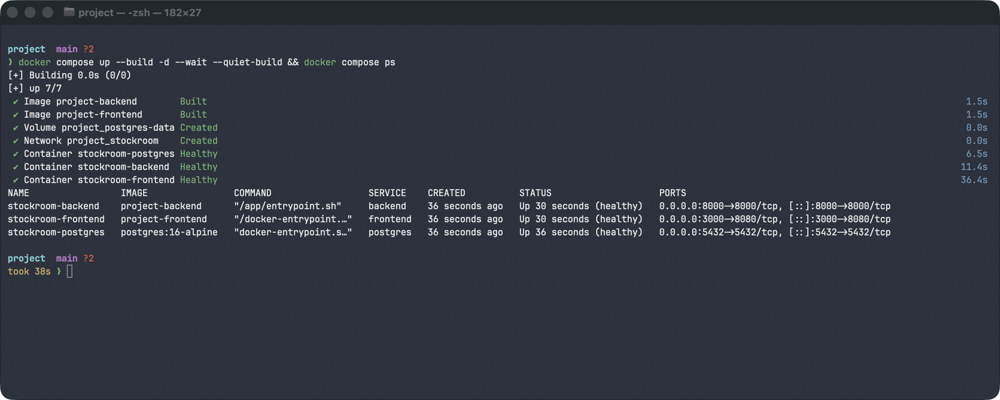 |
| App at http://localhost:3000 (M4) |  |
| GitHub Actions green run (M5) | 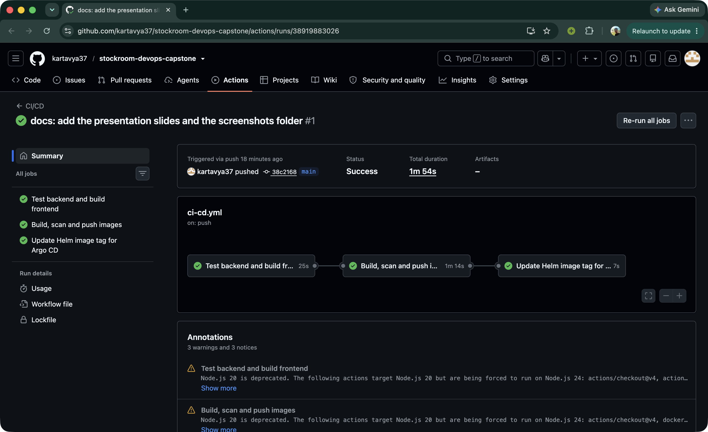 |
| GHCR packages with SHA tags (M5) | 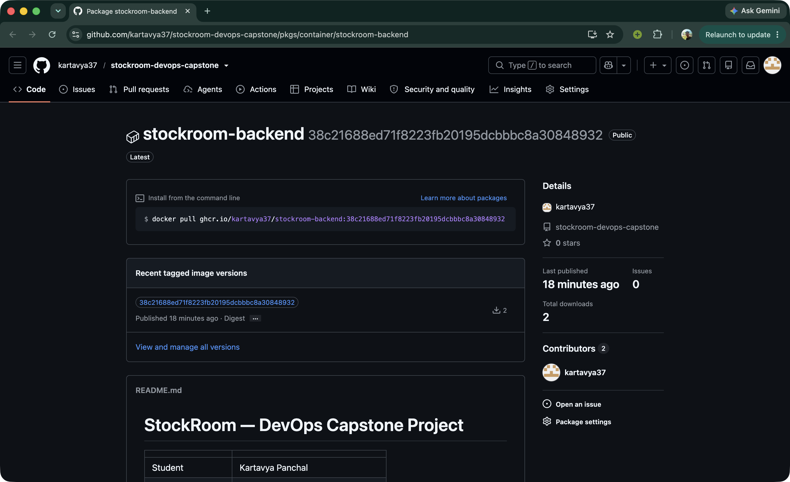 |
| Trivy scan output (M6) | 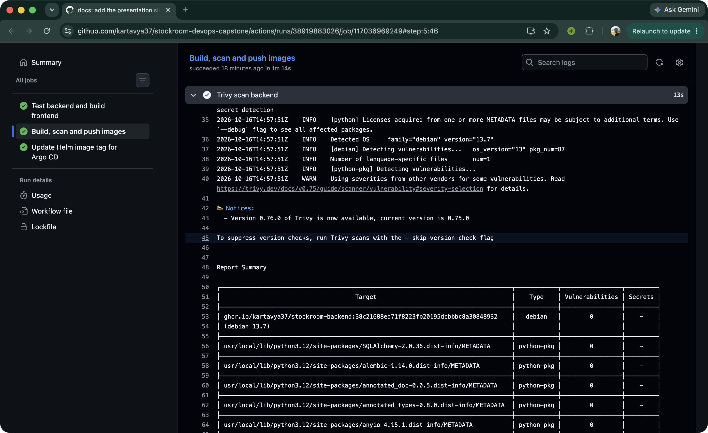 |
| `terraform plan` (M7) | 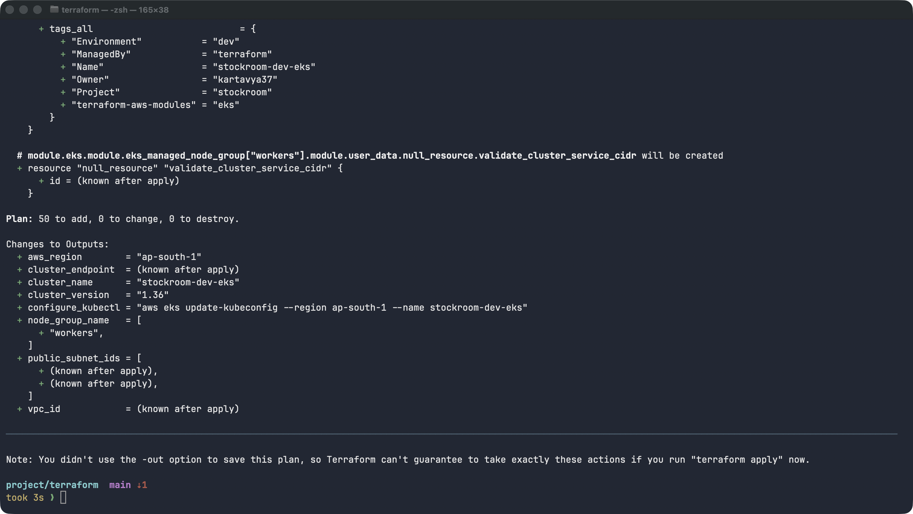 |
| AWS Console: VPC and its two public subnets (M7) |  |
| AWS Console: EKS cluster and node group (M7) |  |
| `terraform destroy` complete (M7) |  |
| `kubectl get pods` (M8) | 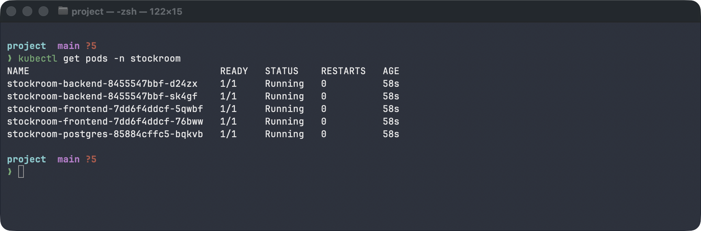 |
| `kubectl get svc` (M8) | 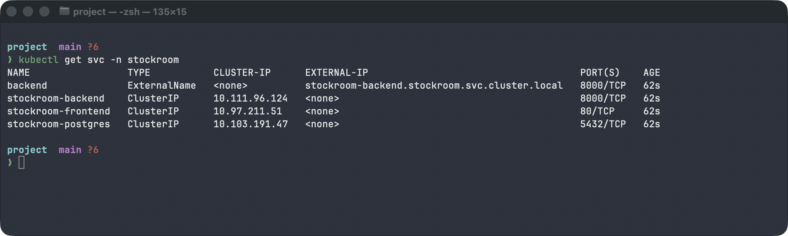 |
| `helm list` (M8) | 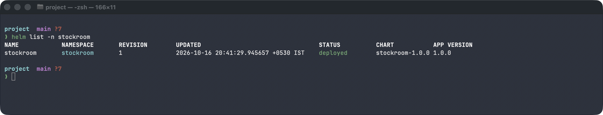 |
| App through the Ingress hostname (M8) | 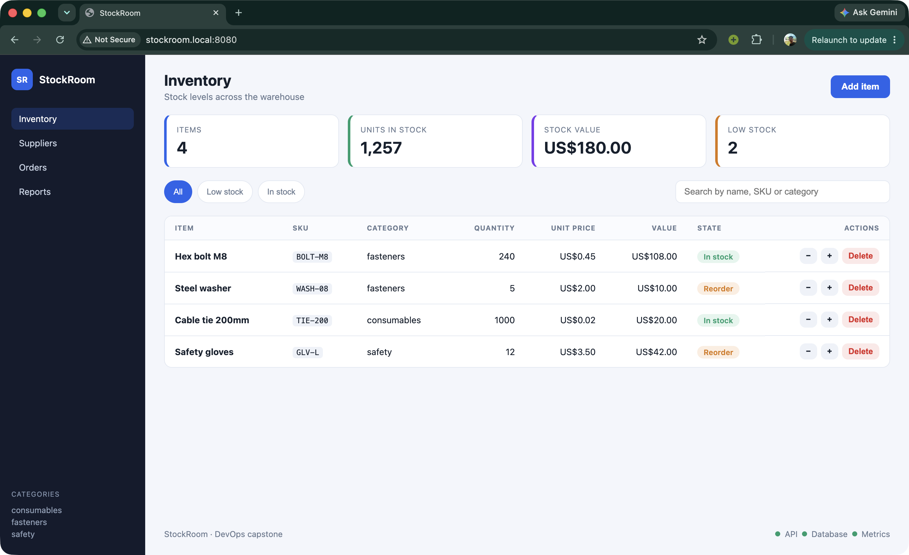 |
| `curl /metrics` (M9) | 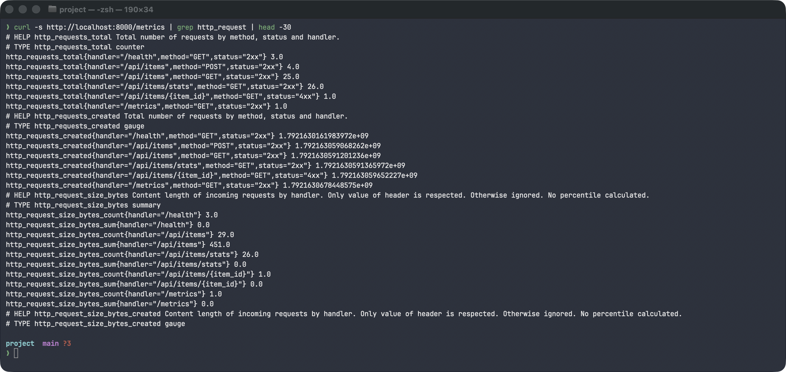 |
| Prometheus Targets page, app `UP` (M9) | 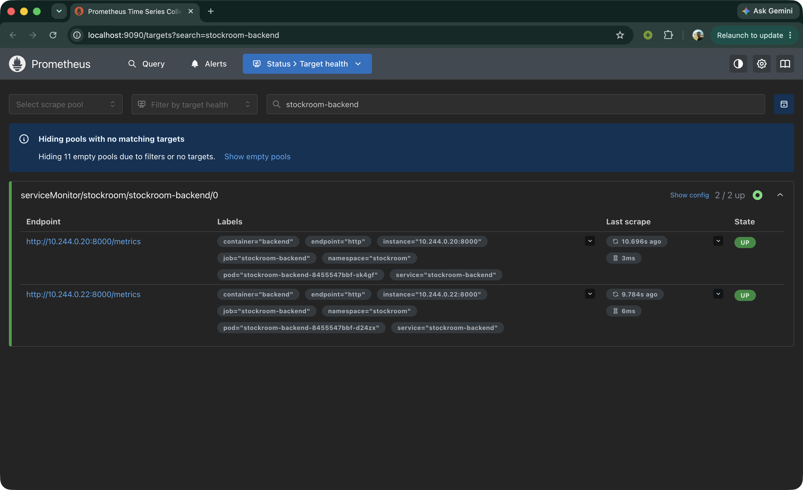 |
| Grafana dashboard with data (M9) | 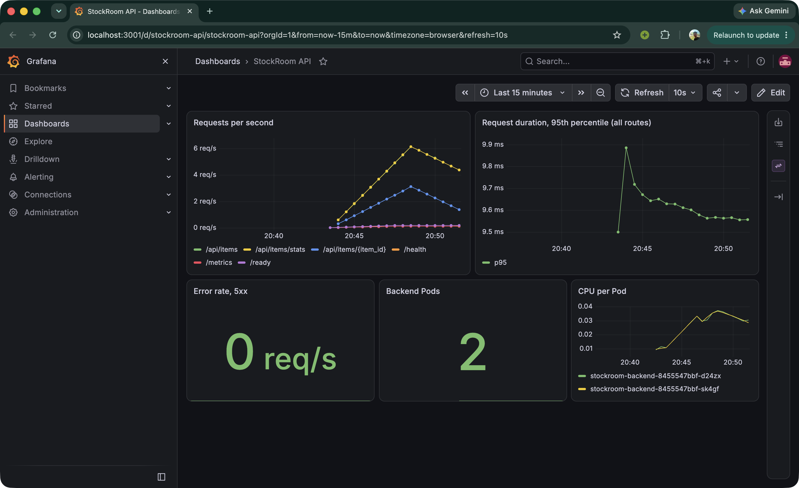 |

## Known issues and limitations

- The app runs on a local Minikube cluster for the demo. The EKS cluster is created with Terraform to show the AWS infrastructure, and it is destroyed after the demo to stop the cost.
- `helm list` is empty after Argo CD takes over, because Argo CD applies the rendered chart itself and does not create a Helm release. The `helm list` screenshot is taken before the hand-over.
- The database password is a plain Helm value. A real setup would use a secrets manager.
- PostgreSQL is one Pod with no replica and no backup. A real setup would use Amazon RDS.
- The EKS worker nodes are in public subnets, to avoid the cost of a NAT gateway. A real setup would put them in private subnets.
- The pipeline commits the image tag to `main` after every run, so run `git pull` before `git push`.
- There is no login, and the Ingress serves plain HTTP.
